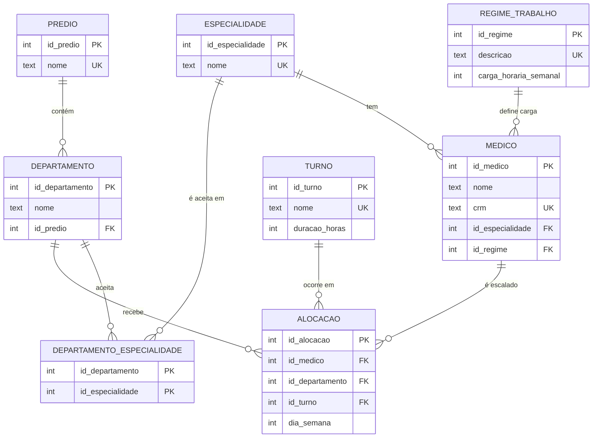

# Projeto Escala Médica

Aplicação que organiza a escala semanal dos médicos de um hospital e responde à pergunta:

> **Em qual prédio e departamento o médico X está no dia Y, turno Z?**

O projeto tem duas partes:

| Parte | Aula | Conteúdo | Pasta |
|---|---|---|---|
| 1 | Aula 1 | Modelagem, scripts DDL/DML e consultas SQL | `database/`, `docs/` |
| 2 | Aula 2 | API REST com Spring Boot sobre o mesmo banco | `backend/` |

## Estrutura

```
projeto-escala-medica/
├── README.md
├── database/
│   ├── base/hospital.sqlite        banco fornecido (médicos, especialidades, regimes)
│   ├── ddl/                        01 a 05: CREATE TABLE das tabelas novas
│   ├── dml/                        01 a 05: INSERTs de prédios, departamentos, turnos e escala
│   ├── queries/                    Q1 a Q6: consultas obrigatórias
│   └── escala.sqlite               banco final (base + DDL + DML), usado pelo backend
├── docs/diagramas/
└── backend/                        projeto Spring Boot (Parte 2)
```

## Modelo de dados



`medico`, `especialidade` e `regime_trabalho` vêm prontas no `hospital.sqlite` e **não são alteradas**.
As tabelas novas apenas apontam para elas por chave estrangeira, por isso nenhum `ALTER TABLE` é necessário.

## Regras de negócio

| Regra | Descrição | Onde é garantida |
|---|---|---|
| RN01 | Médico não pode ter duas alocações no mesmo dia e turno | `UNIQUE` no banco + serviço |
| RN02 | Departamento precisa aceitar a especialidade do médico | serviço (`AlocacaoService`) |
| RN03 | Soma das horas não pode passar da carga do regime | serviço (`AlocacaoService`) |
| RN04 | `dia_semana` de 1 (segunda) a 7 (domingo) | `CHECK` no banco + `@Min/@Max` |
| RN05 | Todo departamento pertence a um prédio | FK `NOT NULL` |
| RN06 | Não alocar médico, departamento ou turno inexistente | FK no banco + serviço |

## Parte 1: montar o banco

1. Copie `database/base/hospital.sqlite` para `database/escala.sqlite`.
2. Abra a cópia no DB Browser for SQLite, DBeaver ou `sqlite3`.
3. Execute `PRAGMA foreign_keys = ON;`.
4. Rode os scripts de `ddl/` e depois os de `dml/`, sempre na ordem numérica.
5. Confira com as consultas de `queries/`. A Q4 deve retornar vazio.

Com o `sqlite3` no terminal:

```bash
cd database
cp base/hospital.sqlite escala.sqlite
cat ddl/*.sql dml/*.sql | sqlite3 -cmd "PRAGMA foreign_keys = ON;" escala.sqlite
```

## Parte 2: rodar o backend

Requisitos: **Java 17 ou superior**. O Maven não precisa estar instalado, o wrapper (`mvnw`) baixa sozinho.

```bash
cd backend
./mvnw spring-boot:run          # Linux / macOS
mvnw.cmd spring-boot:run        # Windows
```

A API sobe em `http://localhost:8080` usando `../database/escala.sqlite`.
Veja `backend/README.md` para a lista de endpoints e `backend/requests.http` para requisições prontas.

## Avaliação P2: Painel de Gestão da Escala

API REST rodando na porta `8081` (`http://localhost:8081`) sobre a base `backend/data/escala_p2.sqlite`, com os 7 relatórios do Painel implementados e coleção de testes salva em `bruno/p2/`.

| Código | Método e Endpoint | Descrição | Status | Responsável |
|---|---|---|---|---|
| **R0** | `GET /api/painel/exemplo/medicos-por-regime` | Quantidade de médicos por regime de trabalho (exemplo) | Implementado (200) | Esqueleto base |
| **R1** | `GET /api/painel/especialidades` | Horas alocadas, total de médicos e médicos escalados por especialidade | Implementado (200) | A preencher pelo grupo |
| **R2** | `GET /api/painel/predios` | Departamentos, plantões, médicos distintos e horas por prédio | Implementado (200) | A preencher pelo grupo |
| **R3** | `GET /api/painel/ranking-carga?limite=5` | Top N médicos com maior percentual de uso da carga semanal | Implementado (200) | A preencher pelo grupo |
| **R4** | `GET /api/painel/departamentos-descobertos?dia=7` | Departamentos sem nenhum médico escalado no dia informado (1 a 7) | Implementado (200) | A preencher pelo grupo |
| **R5** | `GET /api/painel/plantonistas-noturnos?minimo=2` | Médicos com pelo menos `minimo` plantões no turno Noite | Implementado (200) | A preencher pelo grupo |
| **R6** | `GET /api/painel/dias` | Retrato da semana: médicos, departamentos atendidos e horas por dia (1 a 7) | Implementado (200) | A preencher pelo grupo |

### Conferência rápida (`escala_p2.sqlite`)

- **R1:** 12 especialidades; 1ª `Radiologia` (3 médicos, 3 escalados, 108 h) e última `Ginecologia e Obstetrícia` (3 médicos, 1 escalado, 18 h).
- **R2:** `Bloco A` (3 departamentos, 34 plantões, 12 médicos, 210 h), `Bloco B` (3 departamentos, 42 plantões, 15 médicos, 276 h), `Bloco C` (3 departamentos, 34 plantões, 18 médicos, 282 h).
- **R3:** `limite=36` devolve 28 médicos; 1º `Thiago Bastos` (100.0%, 36/36 h) e último `Rodrigo Peixoto` (50.0%, 12/24 h).
- **R4:** `dia=7` devolve 7 departamentos, `dia=6` devolve 5 e `dia=1` devolve 3.
- **R5:** `minimo=2` devolve 5 médicos; `minimo=3` devolve apenas `Thiago Bastos` (3 noites).
- **R6:** 7 dias; `Segunda-feira` (14 médicos, 6 departamentos, 138 h) e `Sexta-feira` (21 médicos, 7 departamentos, 180 h).
